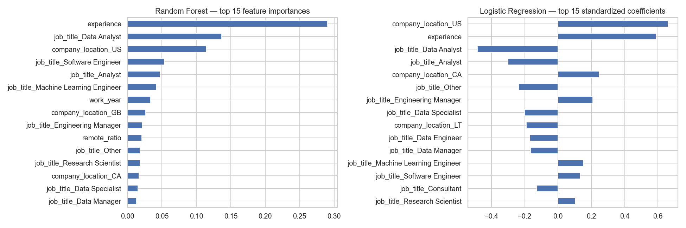

# What Drives a High Data-Science Salary?

**Supervised and unsupervised analysis of 151,445 data / ML / AI job salaries (2020–2025)**
*Machine-learning course project · University of Pennsylvania · 2026*

**Question:** Which job attributes predict whether a data-science role pays above the median ($146,100)?
**Label:** `high_salary` = 1 if `salary_in_usd` > median. The classes are balanced by construction.

**Stack:** Python · pandas · scikit-learn · matplotlib / seaborn · Jupyter

---

## Key findings
| | Result |
|---|---|
| Strongest drivers | **Experience level** (74% of executive roles are above the median vs. 15% of entry-level) and **company location** (54% for US companies vs. 19% elsewhere). Job title adds signal: *Data Analyst* titles are strongly negative, while *ML Engineer* and *Engineering Manager* are positive. |
| Best models | Random Forest, logistic regression and linear SVM are tied at **≈ 70% test accuracy, Cohen's κ ≈ 0.40, ROC-AUC 0.77** |
| Interpretation | Five of the six models land within 0.2 pp of each other, so the ceiling comes from the available features (no skills, industry or seniority detail), not from model choice. |
| PCA | 2 principal components explain only 7.7% of feature variance, yet they keep nearly all the predictive power (69.8% vs. 69.9%) because PC1 is essentially *US vs. non-US*. |
| K-means | Best K = 2 (silhouette 0.92) is a near-perfect split of US vs. non-US companies. It reflects the dataset's geography (90% US) rather than job archetypes. |



## Model comparison (5-fold stratified CV on 80% train, then a 20% held-out test)
| Model | CV accuracy | CV κ | Test accuracy | Test κ |
|---|---|---|---|---|
| Linear SVM | 0.697 | 0.395 | 0.698 | 0.396 |
| Logistic Regression | 0.697 | 0.394 | 0.699 | 0.397 |
| Random Forest | 0.697 | 0.394 | 0.699 | 0.399 |
| AdaBoost | 0.696 | 0.392 | 0.697 | 0.395 |
| Decision Tree | 0.696 | 0.392 | 0.697 | 0.395 |
| Gaussian Naive Bayes | 0.565 | 0.130 | 0.569 | 0.138 |

Grid search (3-fold) on Random Forest and logistic regression did not move test accuracy beyond 0.699.

## Methodology
- **Leakage control:** local-currency `salary` (the target in another unit) and `salary_currency` are dropped.
- **High-cardinality categoricals:** there are 422 job titles, so the top 25 are kept and the rest grouped as `Other`. Countries are capped at the top 15 plus `Other`. A feature flags whether the employee lives in the company's country.
- **Encoding:** experience level and company size are ordinal-encoded, the rest one-hot encoded (48 features). Standardization is fit on the training split only.
- **Evaluation:** accuracy plus Cohen's κ to account for chance agreement, with ROC-AUC for the tuned model.

Full analysis: [`notebooks/salary_classification.ipynb`](notebooks/salary_classification.ipynb)

## Run
```bash
pip install pandas numpy scikit-learn matplotlib seaborn jupyter
# put salaries.csv in data/
jupyter notebook notebooks/salary_classification.ipynb
```

## Limitations
The salaries are self-reported and the data is US-heavy. Converting to USD ignores cost of living. All results are associations, not causal effects.
